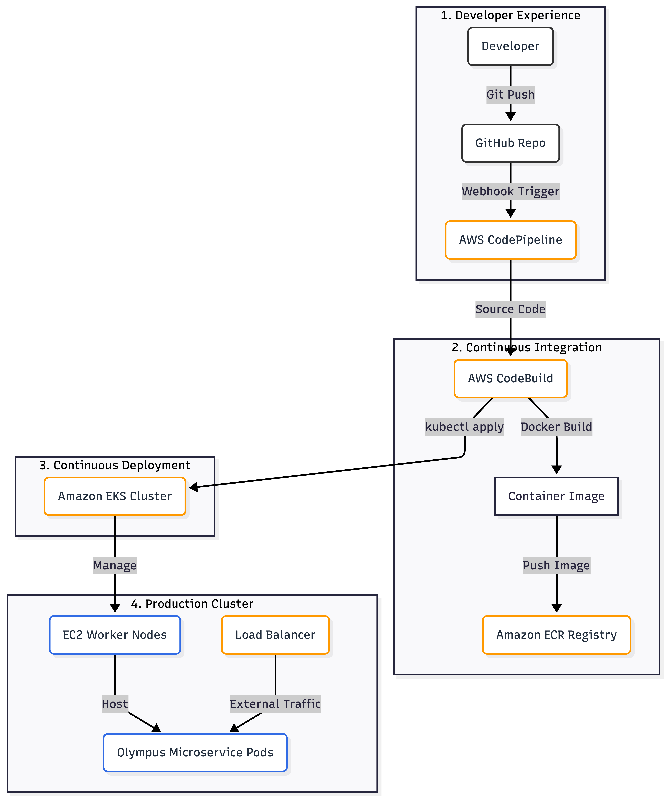
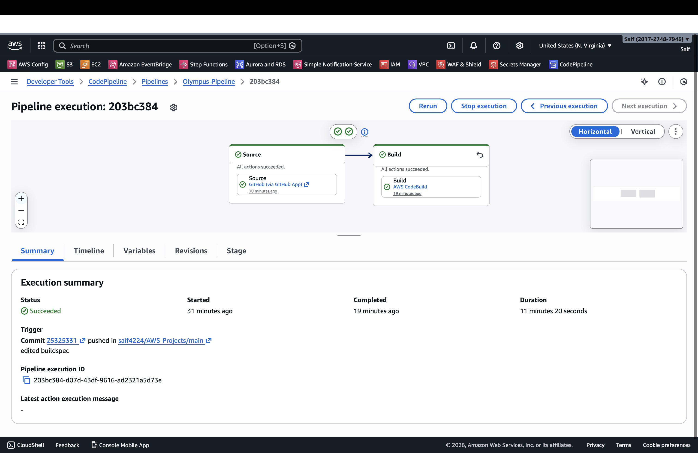
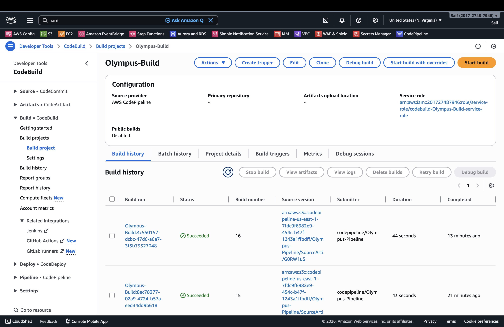
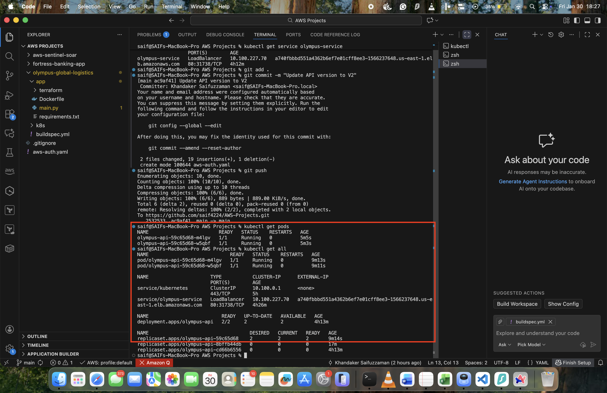
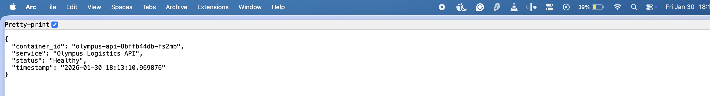
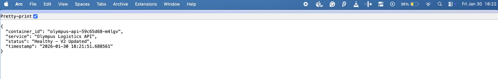
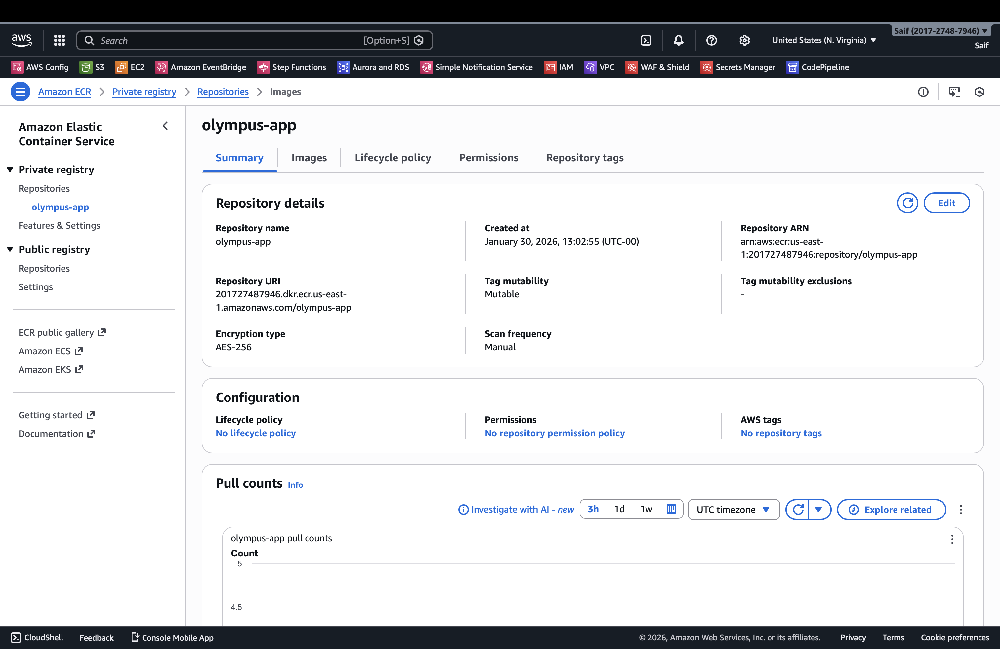
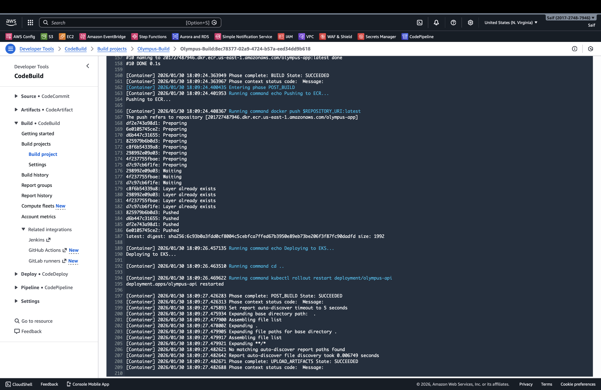
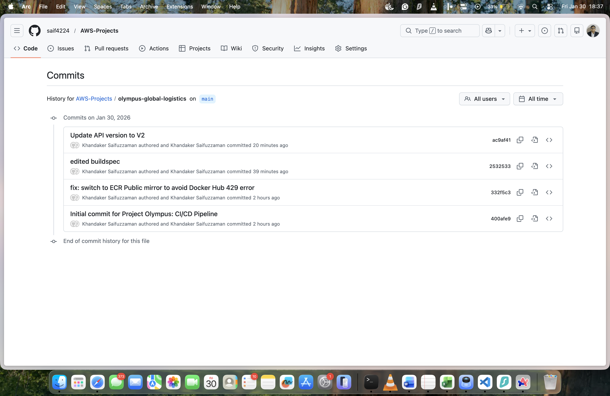

# Olympus: Cloud-Native Microservices on Amazon EKS (Kubernetes) with Docker, CodePipeline, and ECR

[](https://aws.amazon.com/eks/)
[](https://www.docker.com/)
[](https://aws.amazon.com/codepipeline/)
[]()

## Executive Summary:
In the logistics sector, speed is the currency of success. Legacy monolithic architectures prevent rapid feature delivery, leading to downtime during updates and inability to scale during peak shipping seasons.

**Project Olympus** is a strategic initiative to modernize the core "Shipment Tracking" platform into a **Cloud-Native Microservice Architecture**. Hosted on **Amazon Elastic Kubernetes Service (EKS)** and driven by a fully automated **CI/CD Pipeline** using **AWS CodePipeline**, **CodeBuild**, and **Amazon ECR**, this architecture reduces deployment time from days to minutes.

This project demonstrates mastery of the DevOps Lifecycle: **Containerization (Docker)**, **Orchestration (Kubernetes)**, **Continuous Integration**, and **Zero-Downtime Deployment**.


---

## 🏛️ Architectural Blueprint

The architecture implements a high-availability Kubernetes cluster managed by AWS EKS, with a "GitOps" style deployment pipeline that connects source code directly to production infrastructure.




---

## 🔬 Technical Deep Dive

### **1. Microservices Architecture (The Application)**
* **Language:** Python 3.9 (Flask).
* **Design:** Stateless REST API returning JSON shipment data.
* **Containerization:** Packaged via `Dockerfile` using multi-stage builds and the **AWS ECR Public Mirror** (`public.ecr.aws`) to bypass Docker Hub rate limits.

### **2. Orchestration Layer (Amazon EKS)**
* **Control Plane:** Managed Kubernetes master nodes (High Availability across 3 AZs).
* **Data Plane:** Self-managed Node Group utilizing `t3.medium` EC2 instances.
* **Service Discovery:** Kubernetes Service (Type: `LoadBalancer`) automatically provisions an **AWS Classic Load Balancer** to route external traffic to internal Pods.

### **3. The DevSecOps Pipeline (CI/CD)**
Automation is handled by AWS CodePipeline and CodeBuild, removing manual human deployment error.

| Stage | Action | Tooling |
| :--- | :--- | :--- |
| **Source** | Detects changes in the `main` branch of GitHub. | **AWS CodeStar Connection** |
| **Build** | Installs `kubectl`, builds Docker image, tags with Commit ID. | **AWS CodeBuild** |
| **Artifact** | Pushes the immutable image to a private registry. | **Amazon ECR** |
| **Deploy** | Authenticates with EKS RBAC and executes `kubectl rollout restart`. | **CodeBuild + IAM Mapping** |


---

## 📸 Evidence of Execution

The following evidence verifies the successful implementation of the end-to-end pipeline and cluster operations.

### **1. Proof of Automation (The CI/CD Pipeline)**
*The pipeline successfully processing a code change: Source checkout > Docker Build > EKS Deployment.*


### **2. Build Process Transparency (CodeBuild History)**
*Detailed history of build executions, showing successful provisioning of the build environment, Docker image creation, and EKS commands.*


### **3. Proof of Orchestration (Kubernetes Status)**
*Terminal output showing the EKS cluster state: Pods Running, Service Load Balancer active, and Deployment healthy.*


### **4. Proof of Delivery (Zero-Downtime Update)**

This sequence demonstrates a live rolling update. The application remains available while upgrading from **v1** to **v2**.

**State 1: Healthy Baseline (v1)**
*The API responds with status `Healthy`, served by container `olympus-api-cd66...`*


**State 2: Rolling Update Complete (v2)**
*After pushing a code change to GitHub, the pipeline automatically deployed the new version without service interruption.*


### **5. Proof of Artifact Management (ECR)**
*The Container Registry hosting versioned images tagged by Git Commit Hash, ensuring traceability.*


---

### ▼ Operational & Debugging Logs (Click to Expand)

<details>
<summary><strong>Build Logs (CodeBuild)</strong></summary>

<br>

*Detailed logs showing the Docker build process, login to ECR, and the critical `kubectl` commands executing inside the build environment.*


</details>

<br>

<details>
<summary><strong>GitOps History</strong></summary>

<br>

*Commit history proving that infrastructure updates (e.g., "Update API version") were triggered strictly via code commits.*


</details>


---

## 🔧 Operational Playbook

### **Scenario A: Zero-Downtime Deployment**
* **Trigger:** Developer pushes code to GitHub.
* **Mechanism:** Kubernetes performs a Rolling Update. It spins up new `v2` Pods and waits for them to pass health checks before terminating old `v1` Pods.
* **Result:** End users experience zero service interruption during updates.

### **Scenario B: Authentication Failure in Pipeline**
* **Issue:** CodeBuild fails with `error: You must be logged in to the server`.
* **Diagnosis:** The IAM Role used by CodeBuild is not mapped to the `system:masters` group in Kubernetes RBAC.
* **Fix:** Execute `eksctl create iamidentitymapping` to authorize the CodeBuild Service Role within the `aws-auth` ConfigMap.

### **Scenario C: Docker Hub Rate Limiting**
* **Issue:** Build fails with `429 Too Many Requests`.
* **Fix:** Updated `Dockerfile` to pull the base Python image from **Amazon ECR Public Gallery** (`public.ecr.aws`) instead of Docker Hub.


---

## 💰 Cost Analysis (FinOps)

Kubernetes provides density and scale but comes with a base cost.

| Resource | Cost Model | Monthly Estimate | Note |
| :--- | :--- | :--- | :--- |
| **EKS Control Plane** | $0.10/hour | ~$73.00 | Fixed cost per cluster. |
| **Worker Nodes (x2)** | EC2 On-Demand | ~$60.00 | Can be reduced by 70% using Spot Instances. |
| **Load Balancer** | Hourly + Data | ~$18.00 | Classic Load Balancer (CLB). |
| **CodePipeline** | Per Active Pipeline | $1.00 | Free tier eligible (1 free pipeline). |
| **Total** | | **~$152.00 / mo** | Recommended for Enterprise workloads. |

---

## 🛠️ Deployment Instructions

**Prerequisites:** Docker Desktop, AWS CLI, `kubectl`, `eksctl`.

1.  **Clone Repository:**
    ```bash
    git clone https://github.com/saif4224/olympus-cloud-microservices.git
    cd olympus-cloud-microservices
    ```

2.  **Provision Cluster (Infrastructure):**
    ```bash
    eksctl create cluster --name olympus-cluster --region us-east-1 --nodes 2
    ```

3.  **Configure Pipeline (Automation):**
    * Create a CodePipeline V2.
    * Connect GitHub Source (Main Branch).
    * Point CodeBuild to `buildspec.yml`.
    * **Critical:** Update IAM Permissions to allow CodeBuild to run `kubectl`.


      ---

## 👨‍💻 About the Author
**KHANDAKER SAIFUZZAMAN**

**Aspirant Cloud Engineer | AWS Certified Solutions Architect - Associate** 

**CompTIA Security+ Certified** | **MSc Cybersecurity (United Kingdom)**

I specialize in **Modernization**—migrating legacy workloads to Cloud-Native architectures. This project demonstrates my ability to build **Self-Healing Systems** using Kubernetes and automate the software delivery lifecycle using CI/CD.

[Connect on LinkedIn](https://www.linkedin.com/in/khandakersaifuzzaman) 
